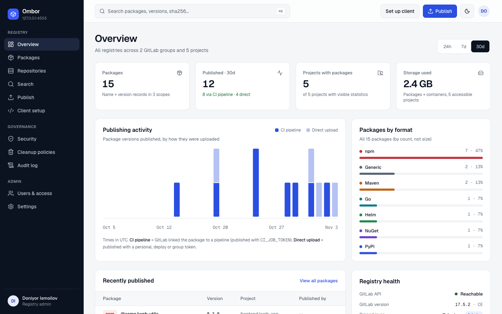
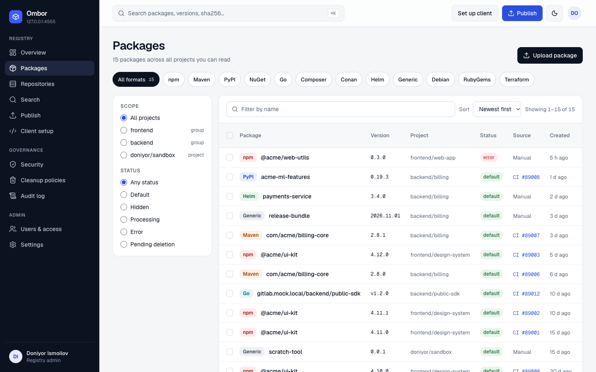
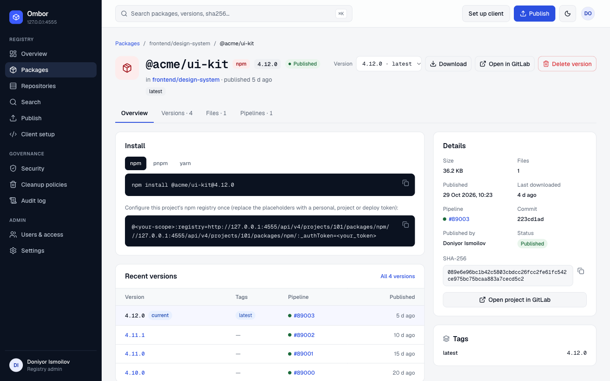
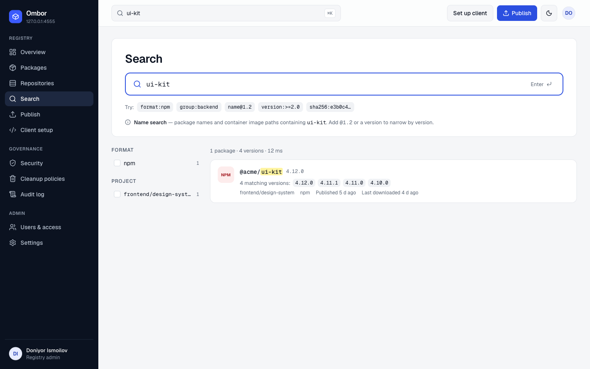
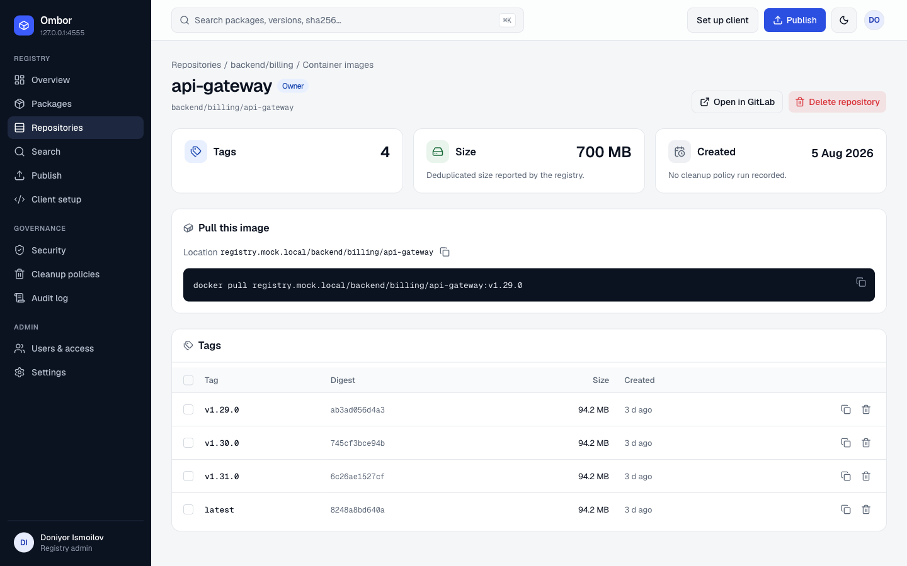
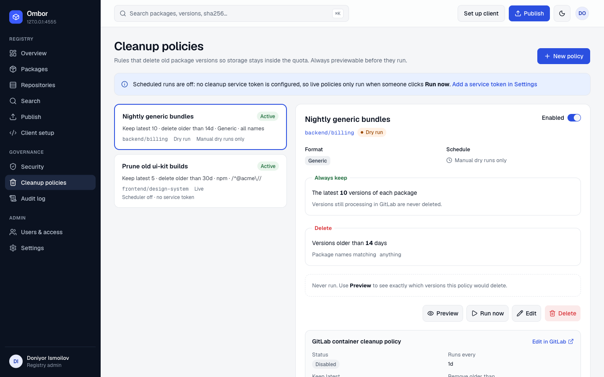
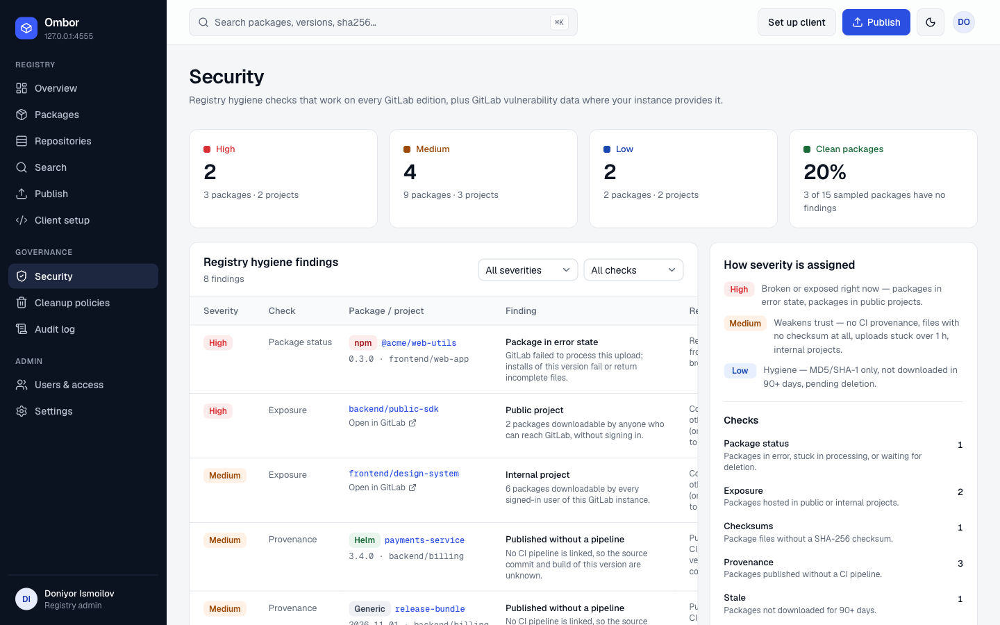

# Ombor

[](https://github.com/ismoilovdevml/gitlab-package-registry/actions/workflows/ci.yml)

**A Nexus/Artifactory-style UI for the self-hosted GitLab Package & Container Registry.**

Browse, search, publish and clean up packages across every GitLab group from one place.
Users sign in with GitLab; every request runs with their own token, so GitLab roles decide what they can see and do.



## Features

- **One catalog**: npm, Maven, PyPI, NuGet, Go, Composer, Conan, Helm, Generic, Debian, RubyGems, Terraform and container images across all groups and projects
- **Package detail**: versions, files with checksums, pipelines, copy-paste install commands
- **Search**: by name, `name@version`, or sha256/sha1/md5
- **Publish**: upload Generic packages and Helm charts from the browser
- **Cleanup policies**: keep-latest-N / older-than-N-days, with preview, dry run and a scheduler
- **Security**: registry hygiene checks on any edition, plus vulnerabilities on GitLab Ultimate
- **Audit log**: logins, publishes, deletes and settings changes, with CSV export
- **Admin**: Ombor users (admin role, block, revoke sessions) and GitLab connection settings

| Packages | Package detail |
|---|---|
|  |  |
| **Search** | **Container tags** |
|  |  |
| **Cleanup policies** | **Security** |
|  |  |

## Quick start

1. **Create a GitLab OAuth app** (Admin Area → Applications):
   - Redirect URI: `https://<ombor-host>/api/auth/callback`
   - Scopes: `api` and `read_user`
   - Confidential: on
2. **Run Ombor:**
   ```bash
   cp .env.example .env   # set APP_URL, SESSION_SECRET, POSTGRES_PASSWORD
   docker compose up -d --build   # or pull ghcr.io/ismoilovdevml/ombor:latest
   ```
3. **Open `APP_URL`.** The setup wizard asks for the GitLab URL and the OAuth Client ID/Secret.
   **The first user to sign in becomes the admin.**

Health check: `GET /api/health`.

## Configuration

| Variable | Required | Purpose |
|---|---|---|
| `APP_URL` | yes | Public URL. The OAuth redirect URI is `${APP_URL}/api/auth/callback` |
| `SESSION_SECRET` | yes | At least 32 characters (`openssl rand -base64 48`). Encrypts tokens and secrets at rest |
| `DATABASE_URL` | yes | PostgreSQL. Compose builds it from `POSTGRES_PASSWORD` |
| `NODE_EXTRA_CA_CERTS` | no | CA bundle for a self-signed GitLab certificate |
| `CLEANUP_INTERVAL_MINUTES` | no | How often scheduled cleanup runs. Default 1440 |
| `COOKIE_SECURE` | no | Set `false` only for plain-HTTP test setups |

The GitLab URL and OAuth credentials are stored in the database and can be changed in **Settings** without a restart.
Scheduled cleanup needs a service token (`api` scope, Maintainer), which is also set in **Settings**.

## Permissions

| GitLab role | In Ombor |
|---|---|
| Reporter | View packages and images |
| Developer | Publish |
| Maintainer | Delete versions, files and tags; manage cleanup policies |

## Security

- OAuth tokens are stored server-side and encrypted with AES-256-GCM; the browser only gets an opaque httpOnly session cookie.
- Access tokens are refreshed automatically.
- Every write is checked against the user's GitLab role and written to the audit log.

## Development

```bash
pnpm install
cp .env.example .env.local   # DATABASE_URL, SESSION_SECRET, APP_URL
pnpm dev
```

The database schema is applied automatically on startup.

| Command | What it does |
|---|---|
| `pnpm lint` / `pnpm typecheck` | ESLint, TypeScript |
| `pnpm test` | Unit tests (Vitest) |
| `pnpm build && pnpm test:e2e` | End-to-end tests (Playwright) against the production build and a mock GitLab (`e2e/mock-gitlab.mjs`); needs `DATABASE_URL` |

CI runs all of the above on every push and PR. The Docker image is smoke-tested and then pushed to `ghcr.io/ismoilovdevml/ombor` (multi-arch, tags `latest`, `sha-…`, `vX.Y.Z`).

```
src/app/          routes: (app) signed-in pages, (auth) sign-in, (setup) wizard, api/
src/lib/          gitlab client & APIs, session, db, audit, per-feature logic
src/components/   ui primitives and shared Ombor components
e2e/              Playwright specs and the mock GitLab server
docs/             screenshots
```

**Stack:** Next.js 16, React 19, Tailwind CSS 4, PostgreSQL with Drizzle.
